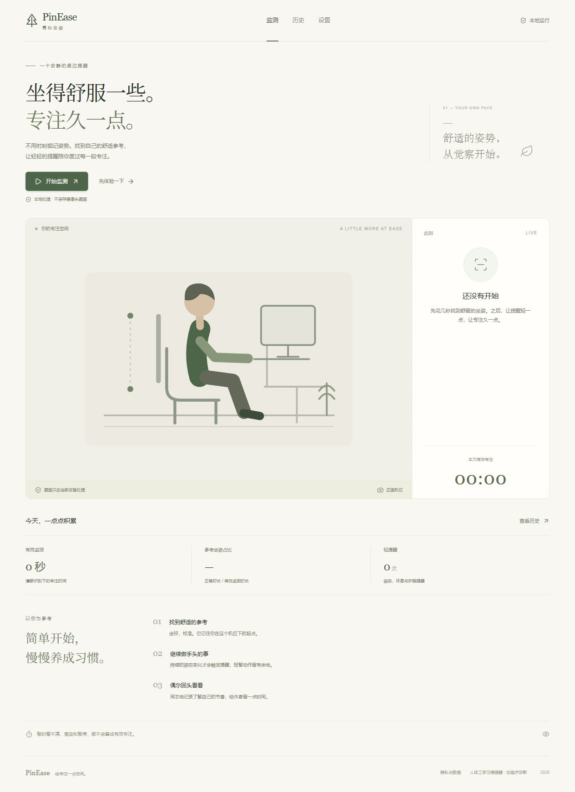

# PinEase · 青松坐姿

一个安静的桌边坐姿提醒。

这是从原 `PinEase` Vue 3 + TypeScript 工程复制后扩展的独立版本，目录为 **PinEase-Complete**，版本号 **1.0.0**。可以用于学习、现场演示和继续开发。

## 最快启动

本机依赖和识别模型已经准备好。

**Windows：双击目录里的「启动项目.bat」**，然后用 Chrome / Edge 打开：

http://localhost:5180/

或在这个目录运行：

```powershell
npm.cmd run dev
```

请使用终端显示的端口；若 5180 被占用，Vite 会提示其他端口。建议一直使用同一个地址，`localhost` 与 `127.0.0.1`、不同端口分别拥有自己的浏览器存储。

不要直接双击 `index.html`。网页模块、Worker 和摄像头需要通过本地服务或 HTTPS 打开。

## 外观模式

在设置页的「外观」中选择跟随系统、日间模式或夜间模式。默认跟随系统，手动选择保存在当前浏览器；图表、弹窗和插画同步切换。

## 第一次使用

1. 点击 **开始监测**，本人允许浏览器使用摄像头。
2. 让头部与双肩进入画面。侧面模式需要看清一侧耳朵与肩膀。
3. 舒适地坐好，点击 **开始 8 秒校准**，尽量保持稳定。
4. 校准成功后进入监测。短暂偏离先进入候选状态，持续达到设置的时间才提醒。
5. **暂停**会关闭摄像头并停止有效计时；**继续**重新打开设备。
6. **结束本次**会保存记录。到历史页查看趋势与提醒。
7. 换机位、摄像头或画面比例后重新校准。

不是越僵直越好。参考值来自你在这个机位下的舒适坐姿，软件用于日常姿态觉察，不提供医学诊断。

## 不开摄像头也能展示

点击 **先体验一下**：

- 不请求摄像头，不加载识别模型。
- 可以切换舒适坐姿、持续低头、离开座位，展示候选异常、持续提醒、恢复和计时。
- 默认持续偏离 6 秒才触发坐姿提醒。
- 演示记录仅保存在当前页面的内存中，与真实历史分开。
- 历史页的 **看看示例记录**提供明确标注的七天模拟数据。
- 页面关闭后演示记录消失，真实记录仍在浏览器中。

现场先展示演示流程，再由参与者自己授权真实摄像头。演示数据不能当成识别实验结果。

## 已实现的功能

| 功能 | 实现方式 |
| --- | --- |
| 摄像头启动、选择、暂停、继续、结束 | getUserMedia；暂停和结束释放视频轨道 |
| 本地关键点识别 | MediaPipe Tasks Pose Landmarker，Worker 内执行 |
| 正面与侧面模式 | 分别保存相同摄像头下的参考参数 |
| 个体校准 | 8 秒、多帧中位数、至少 20 个主导侧有效样本、稳定性检查 |
| 姿态判定 | 统一像素尺度的几何特征，与个人参考作相对比较 |
| 短时动作过滤 | 指数平滑、持续时间、恢复保持、滞回与提醒冷却 |
| 未识别与离座 | 低质量返回未知；连续 5 秒无姿态结果时标记未检测到人 |
| 有效监测与久坐计时 | 可靠可判定时长累计；暂停、未知、离座单列；离座重置久坐累计 |
| 页面休息提示 | 可退出倒计时；用户手动点击可请求浏览器全屏 |
| 声音与通知 | 默认关闭，由用户开启；页面提醒始终可用 |
| 可选眨眼参考 | Face Landmarker blendshapes，清晰人脸下的近期频率估计 |
| 历史与趋势 | 日记录、7/30 天 ECharts 图表、单次提醒详情 |
| 本地保存 | IndexedDB，周期保存会话、保存参数与参考坐姿 |
| 数据管理 | JSON 备份导入/导出、30 天 CSV 汇总、明确确认后清除 |
| 演示模式 | 模拟状态交互与示例历史，隔离真实记录 |
| 响应式与可访问控件 | 桌面/窄屏布局、键盘焦点、Reka UI 弹窗与开关 |
| 安装与缓存 | Web manifest；生产模式 Service Worker 缓存已访问资源 |

界面选用暖白、深绿、细边框与留白，参考 [Plumb](https://plumbcoach.com/)、[PostureKind](https://posturekind.com/)、[NeckCure](https://neckcure.easyfox.org/zh-cn/) 的简洁表达；布局、图标组合、插画和文案在本项目中重新实现。



## 实际边界

- **浏览器页面**：不控制系统亮度，不遮挡其他应用，不提供系统级常驻悬浮窗。
- **后台行为**：页面转入后台会暂停并关闭摄像头，回来后由用户继续。
- **识别含义**：是相对参考的几何代理，不测量真实脊柱形态，也不判断注意力或是否在操作电脑。
- **正面前移**：使用头肩位置与肩宽变化等代理，可能受镜头、身体移动与转头影响。
- **离座状态**：依据连续无姿态结果定义；相机没拍到人也可能是离开视野，不是独立座位传感器。
- **遮挡/侧面**：必要关键点不可靠时暂不判定；髋部不可见时不输出相应躯干判断。
- **眨眼**：采样率、眼镜、光线与脸部角度会影响估计。有效观察不足时显示空值，不报成零次。
- **数据安全**：不上传、不保存画面和逐帧关键点；参考汇总参数与状态区间会保存在当前浏览器。清除浏览器数据会删除它们。
- **资源**：模型和 WASM 已随目录准备，运行时从本地站点读取；缓存能力取决于浏览器与已有缓存。

本次已通过 TypeScript 检查与生产构建，并查看了默认监控页面的实际预览。未使用你的摄像头验证误报、漏报、眨眼精度或设备功耗；这些应由团队在实际机位记录。

## 技术栈

- Vue 3、TypeScript、Vite、Vue Router、Pinia。
- Tailwind CSS v4：样式构建。
- Reka UI：弹窗与开关的行为、焦点和可访问性。
- Lucide Vue：图标。
- Apache ECharts：趋势图。
- MediaPipe Tasks Vision：姿态与可选人脸关键点。
- idb / IndexedDB：本地数据。

## 目录与学习顺序

```text
src/
├─ App.vue                    页面框架、导航、提醒与隐私说明
├─ views/
│  ├─ MonitorView.vue         监控与校准流程
│  ├─ HistoryView.vue         趋势与会话详情
│  └─ SettingsView.vue        摄像头、提醒与数据设置
├─ components/
│  ├─ CameraPreview.vue       预览与骨架连线
│  ├─ PostureIllustration.vue 本项目的 SVG 坐姿示意
│  ├─ TrendChart.vue          ECharts 封装
│  └─ ui/                    Reka UI 基础控件
├─ domain/
│  ├─ types.ts                数据结构与默认参数
│  └─ posture.ts              质量过滤、特征、校准与分类
├─ stores/monitor.ts          生命周期、状态机、计时、提醒
├─ workers/vision.worker.ts   姿态/人脸模型推理
├─ lib/
│  ├─ vision.ts               摄像头与 Worker 通信
│  ├─ storage.ts              数据库存储与备份校验
│  ├─ format.ts               时间、汇总、导出工具
│  └─ demo.ts                 明确标注的模拟数据
└─ assets/app.css             视觉样式
public/
├─ models/                    官方模型及来源/校验记录
├─ wasm/                      MediaPipe WASM
├─ manifest.webmanifest
└─ sw.js
scripts/prepare-assets.mjs     模型下载与 WASM 复制
docs/实现说明.md               算法、计时、隐私和后续开发
```

建议阅读顺序：`types.ts → posture.ts → monitor.ts → MonitorView.vue → storage.ts → HistoryView.vue → vision.ts / worker`。

每次只修改一条完整数据流。例如添加一个统计：先定义数据，再更新记录与汇总，最后展示图表。不要先填一个与记录无关的固定数字。

## 在另一台电脑准备

推荐 Node.js 24 LTS，最低版本要求见 package.json。复制本目录时，可以排除 `node_modules`、`.npm-cache`、`dist`，保留源码和 `public/models`、`public/wasm`。

```powershell
npm.cmd ci --registry=https://registry.npmmirror.com --cache .npm-cache --no-audit --no-fund
npm.cmd run dev
```

需要重新下载模型时：

```powershell
npm.cmd run prepare:assets
```

模型来自 Google 官方地址；网络需要代理时，按你自己的网络环境设置。已经随目录准备的模型无需再次下载。

## 构建与部署

```powershell
npm.cmd run build
npm.cmd run preview -- --host 127.0.0.1
```

`dist` 是静态部署目录，包含页面、Worker、模型与 WASM。部署到 HTTPS 静态站点后，用户仍需自己授权摄像头。

使用 hash 路由与相对资源路径，可部署到静态子目录。不要漏传模型、WASM 或只打开单个 HTML 文件。生产模式才注册 Service Worker。

## 继续开发与软著材料

- 算法入口是 `domain/posture.ts`。以后可以增加自己的分类器，同时保持质量检查、状态与计时接口一致。
- GPU 训练适合放在独立实验工程中；这一版使用官方关键点模型和规则判定，没有宣称训练了自己的姿态网络。
- 默认阈值是工程起点，要用独立人员、机位与光照评估后再调整。
- 数据结构版本为 1；增加数据库字段时同时维护迁移与导入校验。
- 本副本包含 AI 辅助实现。团队应保留真实来源与修改记录，并按学校及登记系统的当前要求准备材料。
- 依赖、模型、项目自身代码的来源分别记录，不能把第三方模型申明为自主训练。
- 正式申请软件名称、著作权人、开发完成日期与版本仍由团队和老师确认；不要把本目录的版本号当作已经取得的登记成果。

第三方依赖与模型来源见 `THIRD_PARTY_NOTICES.md` 和 `public/models/sources.json`。


## 模型加载回归检查

运行开发服务后，打开 `/tests/vision-smoke.html`。该页不申请摄像头权限，使用实际 Worker 加载姿态和眨眼模型，并推理一张人工空白画面。出现 `ready`（`blink: true`）、`frame` 和 `PASS` 表示加载链路通过，不代表真人识别精度。

Worker 使用模块化 WASM，生产构建也保持 ES 模块格式。加载器工厂在每次任务创建前恢复，兼容姿态/人脸双模型及 CPU 重试。
