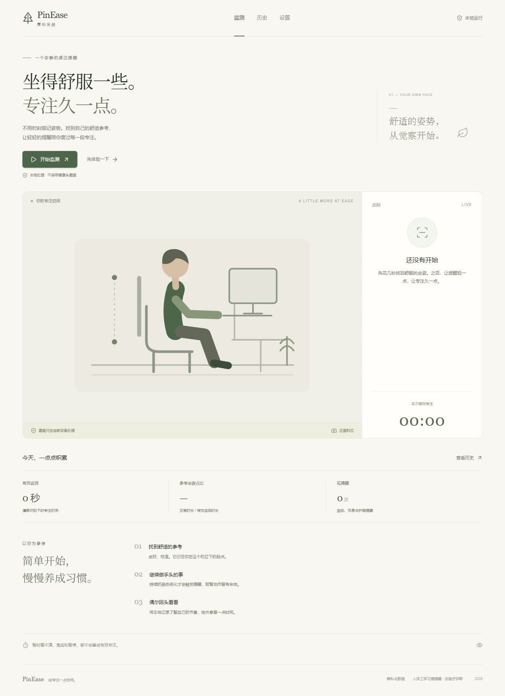

# PinEase · 青松坐姿

一个安静的桌边坐姿与用眼健康助手，支持浏览器直接运行与基于 **Tauri v2** 的轻量级 Windows 桌面客户端。

## 最快启动

```powershell
git clone https://github.com/praxpur/PinEase.git
cd PinEase
npm.cmd ci
npm.cmd run dev
```

启动桌面端开发环境（需本机已配置 Rust 与 Windows WebView2）：

```powershell
npm.cmd run desktop:run
```

## 第一次使用

1. 点击 **开始监测**，允许浏览器或桌面端使用摄像头。
2. 让头部与双肩进入画面；侧面模式需要看清一侧耳朵与肩膀。
3. 舒适地坐好，点击 **开始 8 秒校准**，尽量保持稳定。
4. 校准成功后进入监测。短暂偏离先进入候选状态，持续达到设置的时间才提醒。
5. 可按需开启 **番茄钟模式**，在专注时段同步监测坐姿，进入短休或长休时自动静默坐姿与久坐提醒。
6. **暂停** 会关闭摄像头并停止有效计时；**继续** 重新打开设备。
7. **结束本次** 会保存记录，可到历史页查看健康评分、趋势与提醒明细。
8. 换机位、摄像头或画面比例后建议重新校准。

> 不是越僵直越好。参考值来自你在这个机位下的舒适坐姿，软件用于日常姿态觉察，不提供医学诊断。

## 已实现的功能

| 功能 | 实现方式 |
| --- | --- |
| 摄像头启动、选择、暂停、继续、结束 | `getUserMedia`；暂停和结束立即释放视频轨道 |
| 本地关键点识别 | MediaPipe Tasks Pose Landmarker（Lite / Full），Web Worker 内离屏推理 |
| 正面与侧面模式 | 分别保存同一摄像头下的参考参数，专注于头部与双肩几何关系 |
| 个体校准 | 8 秒采样、多帧中位数、至少 20 个有效样本与稳定性校验 |
| 姿态判定与防抖 | 统一像素尺度的相对几何特征，结合指数平滑、持续时间、滞回与冷却 |
| 头部姿态与眨眼参考 | 可选 Face Landmarker（blendshapes 眨眼频率估计 + 头部俯仰/偏航/滚转参考） |
| 番茄钟模式 | 专注 / 短休 / 长休三阶段循环、阶段切换、进度条、到点提醒、休息期静默姿态/久坐弹窗 |
| 久坐、护眼与微运动 | 久坐/护眼休息倒计时、屏幕护眼滤镜、低光增益（Gamma LUT）、颈部微运动引导 |
| 历史、健康评分与导出 | 日健康评分、7/30 天 ECharts 趋势图、单次提醒详情、JSON 备份导入/导出、CSV 与评测汇总导出 |
| 本地保存 | IndexedDB（`idb`）持久化会话记录、配置项与个人校准基线 |
| 演示模式 | 无需摄像头即可体验状态流转与 7 天示例历史，与真实记录完全隔离 |
| Tauri v2 桌面端 | 轻量原生窗口与无边框主题同步标题栏、系统托盘常驻、锁屏/休眠自动暂停监测与番茄钟 |

界面选用暖白、深绿、细边框与留白，参考 [Plumb](https://plumbcoach.com/)、[PostureKind](https://posturekind.com/)、[NeckCure](https://neckcure.easyfox.org/zh-cn/) 的简洁表达；布局、图标组合、插画和文案在本项目中重新实现。



## 实际边界

- **本地推理与隐私**：不上传、不保存摄像头原始画面和逐帧关键点；汇总记录、偏好设置与参考坐姿仅保存在当前浏览器或桌面端本地存储中。
- **浏览器与桌面端差异**：浏览器版不控制系统亮度，不提供系统级常驻悬浮窗，页面切后台时会暂停并释放摄像头；桌面版支持托盘常驻与锁屏/休眠监听。
- **识别含义**：采用头肩及面部几何特征作为相对个人基准的代理指标，不测量真实脊柱形态，也不用于医学诊断。
- **遮挡与离座**：必要关键点（如双肩、鼻、耳）不可靠时标记为未知并暂停判定；连续无有效姿态时标记离座并重置久坐累计。
- **眨眼与低光**：采样率、眼镜反光、光线与人脸角度会影响眨眼与面部估计；有效观察不足时显示空值，不虚报为零次。

## 技术栈

- **前端**：Vue 3、TypeScript、Vite 8、Vue Router、Pinia
- **样式与组件**：Tailwind CSS v4、Reka UI、Lucide Vue、Apache ECharts
- **本地视觉推理**：MediaPipe Tasks Vision（Pose Landmarker + Face Landmarker）
- **桌面端外壳**：Tauri v2（Rust + Windows WebView2 + NSIS 安装包）
- **本地存储**：`idb` / IndexedDB

## 项目架构

```text
src/
├─ App.vue                      页面框架、主题/标题栏同步、导航与提醒弹窗
├─ views/
│  ├─ MonitorView.vue           实时监测、校准流程与番茄钟卡片
│  ├─ HistoryView.vue           健康评分、趋势图、会话详情与导出
│  └─ SettingsView.vue          摄像头、模型、提醒、番茄钟与数据管理设置
├─ components/
│  ├─ CameraPreview.vue         摄像头预览、骨架绘制与低光提示
│  ├─ PomodoroCard.vue          番茄钟计时器、阶段切换与完成统计
│  ├─ PostureIllustration.vue   正面/侧面坐姿 SVG 示意图
│  ├─ TrendChart.vue            ECharts 趋势图封装
│  └─ ui/                       Reka UI 基础弹窗与开关控件
├─ domain/
│  ├─ types.ts                  数据结构、状态定义与默认参数
│  ├─ posture.ts                质量过滤、特征提取、校准与姿态分类
│  ├─ pomodoro.ts               番茄钟三阶段状态机与轮次计数
│  ├─ blink.ts                  眨眼周期检测与频率估计
│  └─ fun.ts                    彩蛋动作检测
├─ stores/monitor.ts            核心生命周期、计时、番茄钟联动与提醒调度
├─ workers/vision.worker.ts     MediaPipe 姿态/人脸模型推理 Worker
├─ lib/
│  ├─ desktop.ts                Tauri v2 桌面端桥接（窗口、托盘、通知、休眠监听）
│  ├─ vision.ts                 摄像头调度与 Worker 通信
│  ├─ vision-options.ts         模型组合与硬件回退策略
│  ├─ head-pose.ts              面部矩阵旋转角解析与关联校验
│  ├─ lighting.ts               画面亮度分析与 Gamma LUT 提亮
│  ├─ audio.ts                  Web Audio 提示音合成与试听
│  ├─ storage.ts                IndexedDB 存储、设置校验与备份导入/导出
│  ├─ format.ts                 时长格式化、健康评分、汇总与导出工具
│  └─ demo.ts                   演示状态与示例历史数据
└─ assets/app.css               全局主题与页面样式
src-tauri/
├─ Cargo.toml                   Rust 依赖与 Release 优化配置
├─ tauri.conf.json              窗口、打包与 CSP 安全策略配置
└─ src/
   ├─ lib.rs                    Tauri 命令、系统托盘与单实例控制
   ├─ permissions.rs            受信任来源与摄像头权限控制
   └─ windows_hooks.rs          Windows 锁屏/休眠消息钩子
public/
├─ models/                      官方模型及来源/校验记录
├─ wasm/                        MediaPipe WASM 运行时
├─ theme-init.js                首屏主题初始化脚本（兼容严格 CSP）
├─ manifest.webmanifest
└─ sw.js
scripts/
├─ prepare-assets.mjs           模型下载与 WASM 复制
├─ build-icon.mjs               由 SVG 生成桌面端与网页图标
├─ cargo-cli.mjs / cargo-env.mjs  Rust 工具链环境封装
└─ tauri-cli.mjs                Tauri CLI 与构建前占用清理封装
docs/                           实现说明与专项检查文档
tests/                          Node 单元测试与视觉加载冒烟页
```

建议阅读顺序：`types.ts → posture.ts → pomodoro.ts → monitor.ts → MonitorView.vue → storage.ts → vision.ts / worker`。

## 构建、测试与桌面打包

### 网页端测试与构建

```powershell
npm.cmd test
npm.cmd run type-check
npm.cmd run build
npm.cmd run preview -- --host 127.0.0.1
```

`dist/` 为静态部署目录，包含页面、Worker、模型与 WASM。需要重新拉取模型与 WASM 时运行 `npm.cmd run prepare:assets`。

### Windows 桌面版（Tauri v2）

```powershell
npm.cmd run test:rust
npm.cmd run desktop:run
npm.cmd run build:desktop
```

- `desktop:run`：启动 Vite 开发服务并拉起 Tauri 桌面窗口。
- `build:desktop`：执行类型检查、前端生产构建并编译打包 Windows 桌面端：
  - 单文件便携版主程序：`src-tauri/target/release/PinEase.exe`
  - Windows x64 NSIS 安装包：`src-tauri/target/release/bundle/nsis/PinEase_1.0.0_x64-setup.exe`
- 桌面图标由 `public/icon.svg` 自动生成，运行 `npm.cmd run build:icon` 可单独更新图标资源。
- 构建脚本会在打包前自动处理旧版运行中残留的 `PinEase.exe` 占用；关闭窗口默认最小化到系统托盘，系统锁定或休眠时自动暂停监测与番茄钟，退出托盘会先保存当前会话记录。

## 版权与参考说明

- 算法入口位于 `src/domain/posture.ts`，数据结构版本为 `1`。
- 第三方依赖与官方模型来源见 [THIRD_PARTY_NOTICES.md](THIRD_PARTY_NOTICES.md) 和 `public/models/sources.json`。
- 头部转动/抬头/低头检测与眨眼复测说明见 [头部动作与眨眼检查](docs/头部动作与眨眼检查.md)。
